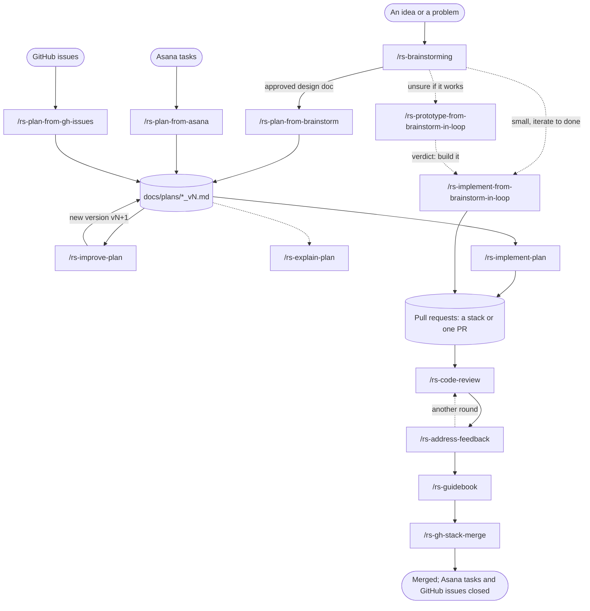

# Harness guide

This repository ships one set of AI workflows to three harnesses: Claude Code, OpenCode, and GitHub
Copilot. The workflows are thirteen `rs-*` commands, 26 skills, and a handful of subagents. The commands
take an idea from a first conversation to merged pull requests. The skills hold know-how for one area of
the code and load when the work touches that area.

Claude Code's copies are canonical. The other two harnesses get ports (see
[Keeping the harnesses in sync](#keeping-the-harnesses-in-sync)).

## Where everything lives

| What | Claude Code | OpenCode | Copilot |
|---|---|---|---|
| Commands | `.claude/commands/rs-*.md` | `.opencode/command/rs-*.md` | `.github/prompts/rs-*.prompt.md` |
| Skills | `.claude/skills/<name>/SKILL.md` | `.opencode/skills/` (symlinks to `.claude/skills/`) | `.github/skills/` (copies) |
| Subagents | `.claude/agents/` | `.opencode/agent/`, `.opencode/agents/` | `.github/agents/` |
| Project guidance | `CLAUDE.md` | `AGENTS.md` (points at `CLAUDE.md`) | `.github/copilot-instructions.md` (points at `CLAUDE.md`) |
| Run logs | `docs/harness_logs/claude-code/` | `docs/harness_logs/opencode/` | `docs/harness_logs/copilot/` |

`make inventory` fails when a Claude command or skill is missing from OpenCode or Copilot.
`ai_tools_notes.md` explains the deliberate gaps.

## The flow

Solid arrows are the main path. Dotted arrows are optional steps or shortcuts.

The main path, in words:

1. **Decide.** `/rs-brainstorming` grills you about the idea until the design holds up, and saves it to
   `docs/brainstorming/`. If the work already exists as Asana tasks or GitHub issues, skip this and start
   at step 2 with those as input.
2. **Plan.** `/rs-plan-from-brainstorm` (or `-from-asana`, `-from-gh-issues`) turns the input into a plan
   in `docs/plans/`, split into units that each become one branch.
3. **Check the plan.** `/rs-improve-plan` audits the plan against today's code and writes the next
   version. `/rs-explain-plan` publishes a readable page about it. Both are optional.
4. **Build.** `/rs-implement-plan` implements the plan with test-first commits, audits each unit, and
   opens the pull requests.
5. **Review.** `/rs-code-review` posts findings as inline PR comments. `/rs-address-feedback` applies or
   rejects every open comment and replies in each thread. Repeat until nothing is left.
6. **Report.** `/rs-guidebook` publishes one page that shows the whole chain with every finding and its
   outcome, for whoever decides on the merge.
7. **Merge.** `/rs-gh-stack-merge` merges the chain and closes the Asana tasks and GitHub issues it
   delivered.

Two loop commands are the shortcut for work that does not need a written plan: they build straight from
a brainstorm until a checklist you agreed on passes.

## Which command to use

| You want to | Use |
|---|---|
| Think a decision through before any code | `/rs-brainstorming <idea>` |
| Turn an approved brainstorm into a plan | `/rs-plan-from-brainstorm <brainstorm.md>` |
| Plan from Asana tasks | `/rs-plan-from-asana <task-url>... \| @<assignee>` |
| Plan from GitHub issues | `/rs-plan-from-gh-issues all \| <issue#>... \| @<assignee>` |
| Check a plan that may be stale, or tighten it | `/rs-improve-plan <plan.md>` |
| Show a plan to someone who has not read it | `/rs-explain-plan <plan.md> [audience]` |
| Implement a plan and open its PRs | `/rs-implement-plan <plan.md>...` |
| Answer "would this even work?" with throwaway code | `/rs-prototype-from-brainstorm-in-loop [brainstorm.md] <question>` |
| Build a brainstorm's design directly, iterating until done | `/rs-implement-from-brainstorm-in-loop <brainstorm.md> [slice]` |
| Review a PR or a whole stack | `/rs-code-review [PR#\|branch] [--all-lenses]` |
| Act on review comments | `/rs-address-feedback [PR#\|branch]` |
| Summarise a PR chain for the person who merges it | `/rs-guidebook [PR#\|branch] [plan.md]` |
| Merge a stack and close its sources | `/rs-gh-stack-merge [stack\|PR#\|branch]` |

Choosing between the three ways to build:

| Situation | Use |
|---|---|
| Several units, ordered branches, or anything risky | `/rs-plan-from-*`, then `/rs-implement-plan` |
| One slice with a clear, checkable "done", no plan needed | `/rs-implement-from-brainstorm-in-loop` |
| You do not yet know whether the idea works or how it should look | `/rs-prototype-from-brainstorm-in-loop` |

## Commands

| Command | Purpose | Reads | Writes | Stops to ask you |
|---|---|---|---|---|
| `rs-brainstorming` | Stress-tests an idea. Classifies it as a spike, bounded change, or architectural change, then asks questions in rounds and pushes back once on every answer. | The idea, the code | `docs/brainstorming/<date>_brainstorm_v<N>_<slug>.md` (architectural only) | Every round; final approval of the design |
| `rs-plan-from-brainstorm` | Turns an approved brainstorm into a plan sized as lightweight, standard, or full. | Brainstorm doc, every file it names | `docs/plans/<date>_plan_<slug>_v<N>.md` | The file tree and names before drafting; approval of the plan |
| `rs-plan-from-asana` | Same as above, from Asana tasks. Only explicit task text and confirmed comments count as decided. | Asana tasks and comments | Plan file(s), one per subsystem | Open questions; structure; approval |
| `rs-plan-from-gh-issues` | Same as above, from GitHub issues. Each unit names the issues it closes. | Issues and comments | Plan file(s), one per subsystem | Open questions; structure; approval |
| `rs-improve-plan` | Audits a plan against the live code and writes a complete new version with a changelog. Never edits the old file. | Plan, source doc, code | `<plan>_v<N+1>.md`, `review.md` log | Approve, request changes, or cancel the new version |
| `rs-explain-plan` | Explains a plan as a page with diagrams and tables for a newcomer. Claude Code publishes it as an artifact; OpenCode and Copilot write the local HTML file. Changes nothing else. | Plan, brainstorm, `CLAUDE.md`, code | `explainer.html`; also a published artifact in Claude Code | Only if the plan path is unclear |
| `rs-implement-plan` | Implements one or more plans unit by unit, test first, with per-unit audits and a final review. Opens PRs. | Plan(s), code | Unit branches, commits, `ledger.md`, PRs | One checkpoint before any code: start point, sources, and PR shape (stack, one PR, or none; draft or ready) |
| `rs-implement-from-brainstorm-in-loop` | Builds a brainstorm slice on `loop/<slug>` with a draft PR, iterating until every agreed check passes. | Brainstorm, code | Branch, commits, draft PR, `loop.md` | Scope, definition of done, budget, base; your verdict on each user check |
| `rs-prototype-from-brainstorm-in-loop` | Builds throwaway code on `prototype/<slug>` that answers one question, looping on your verdict. | Question, optional brainstorm | Prototype branch, `loop.md`, verdict in the brainstorm | Question, checklist, budget; your verdict each round |
| `rs-code-review` | Reviews each PR against its own base, bottom to top in a stack, and posts findings as inline comments. Changes no code. | PR diffs, code at the head SHA | PR review comments, `review.md` | Post all, critical only, or cancel |
| `rs-address-feedback` | Decides apply or reject for every unresolved thread, commits and pushes the applies, replies once per thread. Never resolves threads. | PR threads and comments | Commits, pushes, thread replies, `address_feedback.md` | Proceed all, applies only, adjust, or cancel |
| `rs-guidebook` | Explains a PR chain on one page: what it does, how to review each PR, every finding with its outcome, what is still open. Claude Code publishes it as an artifact; OpenCode and Copilot write the local HTML file. Changes nothing. | PRs, threads, local logs | `guidebook.html`; also a published artifact in Claude Code | Only if the PR or plan is unclear |
| `rs-gh-stack-merge` | Merges a whole stack in one `gh stack merge`, then closes the Asana tasks and GitHub issues listed in each PR's `## Source`. | PRs, their `## Source` sections | Merge, closed issues and tasks, `stack_merge.md` | Squash, merge commit, rebase, or cancel |

### Plan tiers

Most planning and building commands size their work by the plan's tier. The tier decides how many review
agents run, so a small change does not pay for a large review.

| Tier | Fits | Planning review | Implementation | Final review |
|---|---|---|---|---|
| Lightweight | A small, contained change to one flow | Self-review | The lead writes code; no per-unit audit | The lead reviews the diff |
| Standard | Multi-file work inside one subsystem | One correctness reviewer | The lead writes code; audit only units the pre-flight pass (Claude: `preflight-scout`) marked moderate or high | `correctness-lens` |
| Full | Several components, interfaces, migrations, security risk, or strict order | Three reviewers in parallel | A fresh `plan-implementer` per unit; every unit audited | `correctness-lens`, `framework-lens`, `guidance-compliance-lens` |

When in doubt the commands choose the heavier tier. `/rs-improve-plan` keeps a plan's tier unless the code
shows a concrete risk, and also runs one OpenCode critic (`opencode-go/muse-spark-1.3-contributor`) on
every tier.

`/rs-code-review` sizes each PR by changed lines instead: under 50 is lightweight (no lenses), 50 to 200 is
standard, and over 200, or any critical finding, is full (all lenses plus a red-team pass).

### Rules every command keeps

- The code wins. Where a plan, a PR body, or a reviewer disagrees with the code, the code is right and
  the disagreement goes in the log.
- Framework claims are checked with Context7 against the version pinned in the lockfile before they are
  written into a plan, a comment, or a fix.
- Nothing is posted, pushed, or merged without one explicit confirmation from you.
- Comments and replies on GitHub start with a harness prefix and the model name, for example
  `CC: Opus 5.5 -> [CRITICAL, 8/10] ...`, `CC: Opus 5.5 -> applied: ...`, or `... -> rejected: ...`.
  OpenCode uses `OPENCODE:` and Copilot `COPILOT:`. `/rs-guidebook` reads these prefixes to report
  outcomes, so keep them exact.
- PR descriptions written by `/rs-implement-plan` end with a `## Source` section. `/rs-gh-stack-merge`
  parses it to close tasks and issues, so its headings and prefixes stay verbatim.

## Subagents

Commands dispatch these; you rarely call them yourself.

### Claude Code (`.claude/agents/`)

All run on Sonnet 5.5 at medium effort.

| Agent | Writes? | Used by | Job |
|---|---|---|---|
| `preflight-scout` | No | `rs-implement-plan`, `rs-improve-plan` | Compares a plan with the live repo: status, risk, and staleness per unit |
| `plan-implementer` | Yes, commits; never pushes | `rs-implement-plan` (full tier) | Implements one unit from a brief file |
| `commit-auditor` | No | `rs-implement-plan` | Checks one unit's diff against its plan section: Spec, Quality, Gate |
| `correctness-lens` | No | `rs-implement-plan`, `rs-improve-plan`, `rs-code-review` | Broken callers, changed behaviour, error and state paths |
| `framework-lens` | No | same three | Correct idiom for the installed framework versions |
| `guidance-compliance-lens` | No | same three | Whether `CLAUDE.md`, `AGENTS.md`, and Copilot instructions still tell the truth |

`/rs-code-review` also spins up general-purpose teammates named `testing`, `security`, `simplification`,
and `red-team` when the diff calls for them.

### OpenCode

| Agent | Model | Job |
|---|---|---|
| `plan-auditor` (`.opencode/agent/`) | default | Interactive: audits and explains plans; read-only |
| `plan-implementer` | `opencode-go/glm-5.3-flash` | Implements one unit for OpenCode's `rs-implement-plan` |
| `plan-retry` | `opencode-go/glm-5.3-flash` | Second attempt at a unit, with a different approach |
| `plan-unit-auditor` | `opencode-go/glm-5.3-flash` | Read-only review of one unit diff |
| `plan-final-review` | `opencode-go/deepseek-v4.1-flash` | Read-only review of the finished branch |

### Copilot (`.github/agents/`)

| Agent | Job |
|---|---|
| Code Explainer | Explains code, architecture, and data flows; read-only |
| Plan Auditor | Audits and explains plans against live code; read-only |
| Plan Explainer | Explains a plan's scope, tier, tasks, and stacked branches; read-only |

## Skills

Skills load on their own when a task matches their description; you can also call one by name. Three
quickstarts and `e2e` carry `disable-model-invocation: true`, so Claude Code loads them only when you ask
(OpenCode ignores the flag).

### Writing

| Skill | Load it when |
|---|---|
| `writing-for-people` | Writing prose a person decides on: a PR description, a guidebook, a run report |
| `writing-for-agents` | Writing anything an agent reads: a skill, an agent definition, a command, `CLAUDE.md` |

### This codebase

| Skill | Load it when |
|---|---|
| `fastapi-service` | Changing `agentic_backend/src/api.py` or `auth.py`: routes, SSE, JWTs, error statuses |
| `django-service` | Working in `web_backend/`: auth, admin, models, migrations, JWT issuing |
| `react-frontend` | Changing `frontend/chat/`: components, streaming, untrusted Markdown, Vitest |
| `codebase-design` | Deciding where a module boundary goes or whether an abstraction pays for itself |

### LangChain, LangGraph, Deep Agents

| Skill | Load it when |
|---|---|
| `ecosystem-primer` | First, for any LangChain, LangGraph, or Deep Agents work; it points to the next skill |
| `langgraph-fundamentals` | Writing any LangGraph code: state, nodes, edges, `Command`, `Send`, streaming |
| `langgraph-persistence` | Checkpointers, `thread_id`, Store, subgraph persistence |
| `langgraph-human-in-the-loop` | `interrupt()`, `Command(resume=...)`, approval flows |
| `langgraph-cli` | `langgraph dev`, `build`, `deploy`, `langgraph.json` |
| `langchain-fundamentals` | `create_agent`, tools, middleware basics |
| `langchain-middleware` | Human approval of tool calls, custom middleware, structured output |
| `langchain-rag` | Building retrieval: loaders, splitters, embeddings, vector stores |
| `langchain-dependencies` | Package versions and installation |
| `deep-agents-core` | Any Deep Agents app: `create_deep_agent()` and its configuration |
| `deep-agents-memory` | Deep Agents memory, persistence, and filesystem backends |
| `deep-agents-orchestration` | Deep Agents subagents, todo planning, human approval |
| `managed-deep-agents` | Managed Deep Agents in LangSmith, the `mda` CLI |
| `langgraph-python-quickstart` | Only on request: scaffold a minimal LangGraph agent |
| `langchain-python-quickstart` | Only on request: scaffold a minimal LangChain agent |
| `deepagents-python-quickstart` | Only on request: scaffold a minimal Deep Agent |

### Evals and parallel work

| Skill | Load it when |
|---|---|
| `eval-engineering` | Agent evals, benchmarks, Harbor tasks, verifiers, calibration |
| `langsmith-online-eval-engineering` | Creating LangSmith online evaluators from traces |
| `swarm` | Fanning many independent items out to subagents. Claude Code only: it needs a `swarm_task` tool the other harnesses lack |
| `e2e` | Only on `/e2e`: writing, running, or explaining a Playwright test of the app. Claude Code only: it drives `AskUserQuestion` and this repo's Compose stack |

## Where the outputs land

| Output | Path | In git? |
|---|---|---|
| Brainstorm | `docs/brainstorming/<YYYYMonDD>_brainstorm_v<N>_<slug>.md` | No (gitignored) |
| Plan | `docs/plans/<YYYYMonDD>_plan_<slug>_v<N>.md` | No (gitignored) |
| Run logs (`review.md`, `address_feedback.md`, `stack_merge.md`, `loop.md`) | `docs/harness_logs/<harness>/<YYYYMonDD>_<slug>/` | No |
| Explainer and guidebook pages | Same run directory, as `explainer.html` and `guidebook.html` | No |
| Implementation ledger | `docs/harness_logs/<harness>/<plan-stem>/ledger.md` (undated, reused across days) | No |
| Log format | `docs/harness_logs/TEMPLATE.md` | Yes |

A rerun on the same day appends a dated section to its log; a later day starts a new directory.
`scripts/log_metrics.py` appends token metrics to a run log, and commands never write token counts
themselves. `/rs-implement-plan` resumes from its ledger: a unit marked `complete` is skipped on a rerun.

## Keeping the harnesses in sync

| Piece | How it reaches OpenCode | How it reaches Copilot |
|---|---|---|
| Skills | `make link-skills` symlinks into `.claude/skills/` | `make sync-copilot` rebuilds `.github/skills/` from scratch |
| Commands | Copied by hand; body matches Claude's byte for byte, frontmatter swapped for `agent: build` and `model: opencode-go/glm-5.3-flash` | Ported by hand to `.github/prompts/`; `allowed-tools` becomes `tools` |
| Guidance | `AGENTS.md` points at `CLAUDE.md` | `.github/copilot-instructions.md` points at `CLAUDE.md` |

Exceptions to know about:

- OpenCode's `rs-implement-plan` has its own body, because it dispatches OpenCode's own workers. Keep it in
  step with Claude's by hand.
- A port carries a short harness note above the body only where a step dispatches something that
  harness cannot reach, such as Claude's read-only lenses. `rs-code-review` and `rs-improve-plan` have
  notes in both ports, and `rs-implement-plan` in Copilot's.
- `swarm` and `e2e` are skipped in both ports (`SKIP_SKILLS` in the `Makefile`).
- Anything hand-written under `.github/skills/` is deleted by the next `make sync-copilot`. Edit
  `.claude/skills/` and re-run the target.

After any harness change, run `make sync-copilot link-skills inventory` and commit what the sync targets changed.

Three workflows watch the harness:

| Workflow | Runs | Does |
|---|---|---|
| `harness_integrity.yml` | On PRs touching harness files | Re-runs `make sync-copilot link-skills` and fails on any drift; runs `make inventory`; checks that `AGENTS.md` and the Copilot instructions still point at `CLAUDE.md` |
| `harness_audit.yml` | By hand only | Claude Code audits all three harnesses against `scripts/harness_audit/prompt.md` and files one issue with the findings |
| `harness-eval.yml` | By hand, or `/harness_eval` on a PR | Runs `/rs-implement-plan` on a frozen task, scores it, and appends the scores to the `eval-history` branch. Gates nothing |
